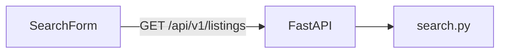

<!--
  Keep it short. Reviewers read the TL;DR and QA Validation first; everything
  else is a checklist. Delete any section that doesn't apply (e.g. Backend on a
  UI-only change) rather than ticking it. Write "N/A — reason" for items you
  skip inside a section that does apply.
-->

## TL;DR

<!-- 1–3 sentences: what changed and why. Link the issue/ticket. -->

Closes #

**Type:** <!-- feature / fix / refactor / chore / docs / test --> · **Area:** <!-- frontend / backend / infra / docs -->

## Files changed

<!-- One line per file or group of files: what changed and why. Group trivial ones ("tests for the above"). -->

| File           | Change | Why |
| -------------- | ------ | --- |
| `path/to/file` |        |     |

<!--
  Diagram — only if it helps (new data flow, request path, state machine,
  component tree). Delete otherwise.


-->

## Frontend checklist

<details open><summary>UI changes</summary>

- [ ] Screenshots or a short recording attached (light **and** dark theme)
- [ ] Works at phone width (~400px) and desktop
- [ ] Every new interactive element is keyboard-reachable, labelled, and has a visible focus style
- [ ] Loading, empty, error and success states handled
- [ ] Styles live in the component's own `*.module.scss` (shared pieces in `styles/ui.module.scss`); colours come from `_tokens.scss`, never raw values
- [ ] New/changed text is plain and specific

</details>

<details open><summary>Frontend tests and coverage</summary>

- [ ] Every new or changed `.ts`/`.tsx` file has a matching `*.test.ts(x)`
- [ ] Accessibility: axe checks added or updated (`src/a11y.test.tsx` or the component's test)
- [ ] `npm run test:coverage` passes, ≥ 95% statements, branches, functions and lines
- [ ] `npm run lint` and `npm run typecheck` clean
- How it was tested: <!-- e.g. "unit tests for X; component test for the error state" -->

</details>

<details open><summary>Frontend manual test (app running)</summary>

- [ ] Started the app (`bash start.sh`) and used the changed UI in the browser at http://localhost:5173
- [ ] Walked through the happy path **and** the edge cases: empty results, validation errors, backend stopped
- [ ] Checked light and dark themes, a phone-width window, and keyboard-only use
- [ ] Browser console free of errors and warnings
- What I did and saw: <!-- e.g. "searched Reston + pool, opened the drawer, Escape returned focus to the card" -->

</details>

## Backend checklist

<details open><summary>API and logic</summary>

- [ ] API change is backwards-compatible within `/api/v1` (or a new version is added)
- [ ] `openapi.json` regenerated (`python -m scripts.export_openapi`) if the API changed
- [ ] New inputs validated in `validation.py`, with errors in the standard envelope
- [ ] New settings added to `config.py` (typed, with a default) and the README
- [ ] Logging: useful, no secrets or personal data logged
- [ ] New or upgraded runtime dependencies: `make audit` clean, or any high/critical finding with no fix noted below (and any override explained)

</details>

<details open><summary>Backend tests and coverage</summary>

- [ ] Unit tests for new logic; HTTP tests for new or changed endpoints
- [ ] `pytest --cov` passes at ≥ 95%
- [ ] `ruff check`, `ruff format --check` and `mypy` clean
- How it was tested: <!-- e.g. "parametrized validation tests; 429 path via the limiter test" -->

</details>

<details open><summary>Backend manual test (API running)</summary>

- [ ] Started the API (`bash start.sh`, or `uvicorn app.main:app --reload --port 8000`) and called the changed endpoints by hand (http://localhost:8000/docs or `curl`)
- [ ] Checked the status codes, response bodies and error envelopes for good **and** bad input
- [ ] `/api/v1/health/ready` returns 200, and the API log shows the requests with request IDs and no unexpected warnings
- Requests I tried: <!-- e.g. "GET /api/v1/listings?sort=price_asc -> 200, cheapest first; ?sort=bogus -> 400 with field error" -->

</details>

## QA Validation

<details open><summary>End-to-end (Playwright)</summary>

- [ ] `npm run test:e2e` passes locally (desktop and mobile projects)
- [ ] New user flows have an e2e spec, or: <!-- why not -->
- [ ] Real-browser accessibility audit (`e2e/a11y.spec.ts`) passes, colour contrast included
- [ ] Key moments in new or changed specs call `evidence.capture('…')`, so they appear below

</details>

<details open><summary>E2E evidence (screenshots + network)</summary>

- [ ] Evidence attached: `cd frontend && npm run pr:evidence:publish` (or `npm run pr:create` to open this PR with it), or N/A: no e2e spec changed
- [ ] Screenshots show the changed UI; the network view shows the expected requests, statuses and responses

<!--
  Generated: don't edit between the markers. `npm run pr:evidence:publish`
  records every test in the e2e spec files this branch changes, with a
  screenshot per step and a DevTools-style network panel of every /api call,
  and replaces this block. If no spec file changed, nothing is recorded and
  this block is left as is. Preview locally first with `npm run pr:evidence`
  (writes frontend/pr-evidence/EVIDENCE.md).
-->
<!-- pr-evidence:start -->
_Not attached yet. Run `npm run pr:evidence:publish` from `frontend/`._
<!-- pr-evidence:end -->

</details>

<details open><summary>Manual verification (author)</summary>

- [ ] Frontend and backend manual tests above are done (or marked N/A with a reason)
- [ ] Ran the whole app together from a clean checkout (`bash start.sh`) and exercised the change end to end

</details>

**Reviewer: please try**

<!-- 2–5 concrete steps the reviewer should do themselves, with the expected result. -->

1. `bash start.sh`, open http://localhost:5173 →
2.

## Notes for reviewers

<!-- Optional: risks, follow-ups, decisions worth a second opinion. Delete if empty. -->
```
