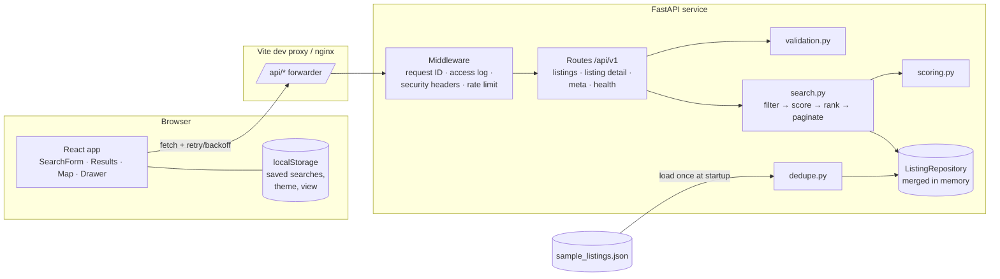

# Listing Search Service

A full-stack search over MLS property listings, built for the Software Engineer coding assessment and hardened to look and behave like an enterprise service (while running on bundled sample data):

- **Backend:** Python 3.10+ and FastAPI. A versioned REST API with validation, deduplication, explainable ranking, structured logging, request IDs, rate limiting, health probes and an OpenAPI contract.
- **Frontend:** React 19 and TypeScript, built with Vite. Card and map views, a detail drawer, saved searches, live search, light and dark themes, retries with backoff and an error boundary.
- **Quality:** ≥ 95% test coverage enforced on both halves, an accessibility suite (axe-core) in jsdom *and* a real browser, Playwright end-to-end tests, linting and type checks, git hooks, a dependency vulnerability gate, CI, a PR template, and e2e screenshots and network captures attached to PRs.

**Contents:** [Quick start](#quick-start) · [Architecture](#architecture) · [API](#api) · [How a search runs](#how-a-search-runs) · [Scoring](#scoring) · [Duplicates](#duplicate-listings-across-feeds) · [Input handling](#input-handling) · [Operations](#operations) · [Frontend](#frontend) · [Styling](#styling) · [Testing](#testing) · [Quality gates](#quality-gates) · [Layout](#project-layout) · [Trade-offs](#trade-offs-and-assumptions) · [Roadmap](#roadmap)

## Quick start

You need Python 3.10 or newer and Node 20.19+ or 22.12+ (required by Vite).

**One command:**

```bash
bash start.sh
```

It checks your Python and Node versions, installs everything on the first run, starts the API on http://localhost:8000 (interactive docs at `/docs`) and the UI on http://localhost:5173. Ctrl+C stops both.

**With Make** (what the git hooks and CI use):

```bash
make setup     # backend venv + dev tools, frontend packages, git hooks
make check     # every linter and test, with coverage gates
make e2e       # Playwright end-to-end suite (starts its own servers)
make ci        # check + e2e: exactly what CI runs
```

**With Docker** (production-like: nginx in front, JSON logs, docs off):

```bash
docker compose up --build    # then open http://localhost:8080
```

**Or run the halves separately**, in two terminals:

```bash
# 1. Backend  ->  http://localhost:8000
cd backend
python -m venv .venv && source .venv/bin/activate      # Windows: .venv\Scripts\activate
pip install -r requirements-dev.txt
uvicorn app.main:app --reload --port 8000

# 2. Frontend ->  http://localhost:5173
cd frontend
npm install
npm run dev
```

In development, Vite forwards `/api/*` to `localhost:8000`, so the frontend has no hard-coded backend URL. Set `API_URL` to point it elsewhere. In Docker, nginx does the same forwarding.

## Architecture



Two rules shape the code:

1. **Logic lives in plain Python modules; HTTP is a thin shell.** `validation`, `dedupe`, `scoring` and `search` know nothing about FastAPI, so they're unit-tested directly. `main.py` only wires them to routes.
2. **Every network call in the UI goes through `api.ts`.** Components never build URLs or handle HTTP; retries, cancellation and error mapping live in one place.

## API

All endpoints are read-only `GET`s under **`/api/v1`**. The interactive docs at http://localhost:8000/docs list every parameter (they're hidden when `LISTING_ENVIRONMENT=production`), and the machine-readable contract is checked in as [`backend/openapi.json`](backend/openapi.json).

| Endpoint | Purpose |
|---|---|
| `GET /api/v1/listings` | Search: filter, rank and paginate (parameters below) |
| `GET /api/v1/listings/{listingKey}` | One listing, in the same shape as a search result. Accepts `targetBudget` and `asOf` so its score matches the search that linked to it. **404** if unknown. |
| `GET /api/v1/meta` | Cities, statuses, sort options and limits, for building a search UI |
| `GET /api/v1/health/live` | Liveness: the process is up |
| `GET /api/v1/health/ready` | Readiness: data loaded and searchable (**200**), or not (**503** with the reason) |
| `GET /api/v1/health` | Summary health, kept for compatibility |

**Versioning:** the original unversioned paths (`/api/listings`, …) still work, because existing clients use them, but every response on them carries `Deprecation: true` and a `Link` header naming the `/api/v1` successor. A breaking change would ship as `/api/v2` next to v1, never by changing v1 in place.

`GET /api/v1/listings` parameters (all optional):

| Param | Type | Notes |
|---|---|---|
| `minPrice`, `maxPrice` | number ≥ 0 | Inclusive. `minPrice > maxPrice` returns 400. |
| `minBedrooms` | integer ≥ 0 | |
| `city` | string | Exact match, ignoring case and extra whitespace. |
| `keyword` | string | Comma-separated terms, e.g. `pool, garage`. Case-insensitive, whole words only, every term must match. |
| `targetBudget` | number > 0 | Drives relevance ranking (see [Scoring](#scoring)). |
| `status` | `active,pending,sold` | Comma-separated. Defaults to `active`. |
| `sort` | `relevance` · `newest` · `price_asc` · `price_desc` · `sqft_desc` | Defaults to `relevance`. Every order ends with the same deterministic tie-breakers. |
| `page` | integer ≥ 1 | Defaults to 1. |
| `pageSize` | integer 1–100 | Defaults to 10. |
| `asOf` | `YYYY-MM-DD` | Reference date for recency. Defaults to today. |

A successful response:

```json
{
  "results": [{
    "listingKey": "55-elm-ct-vienna-va", "address": "55 Elm Ct", "price": 470000, "bedrooms": 3,
    "latitude": 38.9012, "longitude": -77.2653,
    "relevanceScore": 0.8847,
    "scoreBreakdown": { "budget": 1.0, "recency": 0.6156, "daysOnMarket": 21 },
    "sources": [{ "source": "MLS_A", "id": "A5" }, { "source": "MLS_B", "id": "B11" }]
  }],
  "pagination": { "page": 1, "pageSize": 10, "totalResults": 7, "totalPages": 1, "hasPrevious": false, "hasNext": false },
  "warnings": []
}
```

**Errors** all use one envelope (`backend/app/errors.py`), so a client needs one parser. Switch on `code`, never on `message`:

| Status | `code` | When |
|---|---|---|
| 400 | `INVALID_PARAMETERS` | Any bad input. `details` lists **every** bad field at once. |
| 404 | `NOT_FOUND` | Unknown listing or route |
| 405 | `METHOD_NOT_ALLOWED` | Anything but GET |
| 429 | `RATE_LIMITED` | Too many requests; see `Retry-After` |
| 500 | `INTERNAL_ERROR` | A bug. The body carries `requestId` to quote in a report; internals are never exposed. |

```json
{ "error": { "code": "INVALID_PARAMETERS", "message": "One or more search parameters are invalid.",
  "details": [ { "field": "minPrice", "message": "must not be greater than maxPrice (600000 > 500000)" },
               { "field": "pageSize", "message": "must be 1 or greater" } ] } }
```

## How a search runs

```
feed JSON ─► parse & validate records ─► merge duplicates ─► (in memory, once at startup)
request ─► middleware ─► validate params ─► filter ─► score ─► sort ─► paginate ─► JSON
```

Each stage is a small, pure function in its own module:

| Stage | File |
|---|---|
| Settings | `config.py` |
| Request IDs, logs, headers, rate limit, 500 safety net | `middleware.py`, `observability.py` |
| Parameter validation | `validation.py` |
| Duplicate merging | `dedupe.py` |
| Scoring | `scoring.py` |
| Filter, sort, paginate | `search.py` |
| Loading and lookup | `repository.py` |
| Routes and error mapping | `main.py`, `errors.py` |

A new requirement should only need changes in one place: a new filter goes in `matches_filters`, a new sort in `rank` (plus `SORT_OPTIONS`), a new signal in `scoring.py`.

## Scoring

```
relevanceScore = 0.7 × budgetFit + 0.3 × recency          (range 0–1)

budgetFit = max(0, 1 − |price − targetBudget| / (0.25 × targetBudget))
recency   = 0.5 ^ (daysOnMarket / 30)
```

**Budget fit** is a linear fall-off based on the *relative* distance from the target.

| Price relative to target | budgetFit |
|---|---|
| At the target | 1.0 |
| 10% away | 0.6 |
| 25% or more away | 0 |

- **Relative, not absolute:** a $20k gap matters more on a $300k home than on a $3M home.
- **Symmetric:** being over and under budget are scored the same, because a target budget means "around this number", not "at most". Users who need a hard ceiling can use `maxPrice`.

**Recency** uses exponential decay with a 30-day half-life.

| Days on market | recency |
|---|---|
| 0 (new today) | 1.0 |
| 30 | 0.5 |
| 60 | 0.25 |

The curve is smooth: there's no cliff like there would be with a cutoff such as "listed in the last 14 days". It never goes negative, and it has a single parameter that's easy to tune. A listing dated in the future counts as 0 days on market, so its score is capped at 1.

**Weights:** budget gets 0.7 because it's the preference the user stated explicitly. Recency gets 0.3, so freshness can reorder homes with similar fit but can't push a badly priced home to the top. **Without a `targetBudget`**, the score is recency alone.

**Breakdown:** every result includes `scoreBreakdown` (budget fit, recency and days on market), and the UI shows it under the score, so you can always see *why* a listing ranked where it did.

**Ties:** scores are rounded to 4 decimal places, so floating-point noise can't create orderings that don't really exist. Ties are then broken by:

1. Newer listing first
2. Lower price
3. `listingKey`

The same query therefore always returns the same order, and pages never overlap or skip a result.

**Days on market** are counted from `asOf`, which defaults to today. Because the sample data is a few months old, recency values are small and close together today. The *ordering* is still correct, and `asOf` (also under "Advanced" in the UI) lets you reproduce scores as they would have been at listing time. Tests pin `asOf`, so they're deterministic.

## Duplicate listings across feeds

The same home often appears in several feeds. In the sample, A1/B7, A2/B8, A3/B9 and A5/B11 are four such pairs, and their formatting differs (`123 Main St, Apt 4B` vs `123 Main Street, Unit 4B`) and sometimes their facts (456 Oak Ave has zip 22150 in one feed and 22151 in the other). Like consumer portals, this service shows **one result per property**: 12 raw records become 8 listings.

- **Matching:**
  - Records must have the same *normalized* address: lowercased, punctuation removed, `Street→St`, `Avenue→Ave`, and `Apt`/`Unit`/`Suite`/`#` all treated as one unit designator.
  - They must also have the same city and state.
  - Their coordinates must be within 200 m. This guards against false merges.
  - Zip is ignored, because the feeds disagree on it.
- **Merging:**
  - Display fields such as price, address and description come from the **most recently listed** record, the freshest view of the home.
  - `listedDate` is the **earliest** date across feeds, which reflects true time on market, so a feed that picked a home up late can't make it look new.
  - Keyword search runs over **every** feed's description.
- **Traceability:** each result carries a `sources` array listing every contributing feed record with its own id, price and date. An array is used instead of a comma-separated string because ids are only unique *within* a source.

## Input handling

| Situation | Behavior |
|---|---|
| `minPrice > maxPrice`, `pageSize ≤ 0` or > 100, `page < 1`, non-numeric or negative numbers, `targetBudget ≤ 0`, bad dates, unknown status | **400**, listing every field error |
| Unknown parameter (e.g. the typo `minprice`) or a repeated parameter | **400**. Silently ignoring a typo would return wrong results that look right. |
| Blank fields | Treated as not set |
| City with no listings at all | **200** with empty results and a warning listing the cities that do exist. It's a valid question with an empty answer, not a malformed request. |
| `page` past the last page | **200** with empty results, full pagination metadata and a warning. The UI offers "Go to last page". |
| Malformed feed record at load time | Skipped and logged, so one bad record can't take search down. Counted in `/health/ready`. |
| Missing or corrupt data file | The service still starts; `/health/ready` returns **503** with the reason, searches return no results |
| Unknown `sort` | **400** listing the valid options |

The UI turns off the browser's built-in form validation, so the API remains the single source of truth and its field-level messages appear next to the matching inputs.

The UI turns off the browser's built-in form validation, so the API stays the single source of truth and its field-level messages appear next to the matching inputs.

## Operations

These are the features that make the service operable in production. All of them are on by default and configured through environment variables.

### Configuration

Every setting lives in `backend/app/config.py`, typed and validated at startup by pydantic-settings, so a bad value stops the service immediately with a clear message instead of failing on the first request. Set them as environment variables (or in `backend/.env`):

| Variable | Default | Meaning |
|---|---|---|
| `LISTING_ENVIRONMENT` | `development` | `development`, `test` or `production`. Production hides `/docs` and `/openapi.json`. |
| `LISTING_LISTINGS_PATH` | bundled sample | JSON feed file to load at startup |
| `LISTING_LOG_LEVEL` | `INFO` | `DEBUG`, `INFO`, `WARNING`, `ERROR` |
| `LISTING_LOG_FORMAT` | `text` | `json` for one JSON object per line (log aggregators), `text` for humans |
| `LISTING_CORS_ORIGINS` | the Vite dev origins | JSON list of browser origins allowed to call the API directly |
| `LISTING_RATE_LIMIT_ENABLED` | `true` | Turn rate limiting off (the e2e suite does) |
| `LISTING_RATE_LIMIT_PER_MINUTE` | `120` | Sustained requests per minute per client IP |
| `LISTING_RATE_LIMIT_BURST` | `30` | Requests a client may make in a quick burst |

### Observability

- **Request IDs.** Every request gets an ID: the caller's `X-Request-ID` if it's a safe value, otherwise a new UUID. It's on every log line for that request, in the `X-Request-ID` response header, and in 500 error bodies (the UI shows it as "Reference: …"), so a user's report leads straight to the right log lines. nginx starts the ID at the edge in Docker.
- **Structured logs.** One access-log line per request with method, path, query, status, duration and client. With `LISTING_LOG_FORMAT=json` each line is a JSON object, tracebacks included as a single field.
- **Timing.** `Server-Timing: app;dur=…` on every response shows server time in the browser's dev tools.
- **Health probes.** `/health/live` answers whenever the process is up; `/health/ready` answers 503 when the data didn't load. That's the split Kubernetes and load balancers expect: take an unready instance out of rotation, restart only a dead one. The Docker images use readiness for their `HEALTHCHECK`.

### Resilience

- **The service degrades instead of crashing.** A missing or corrupt data file gives an empty, *unready* service with the reason in `/health/ready`, rather than a crash loop. Bad individual records are skipped, logged and counted.
- **A 500 safety net.** Any unhandled exception is logged with its traceback and request ID and becomes a generic 500 in the standard envelope. Internals never reach the client.
- **Rate limiting.** A token bucket per client IP (`middleware.py`): bursts up to `RATE_LIMIT_BURST`, sustained `RATE_LIMIT_PER_MINUTE`. Refusals are 429 with `Retry-After`; every response carries `RateLimit-Limit` and `RateLimit-Remaining`. Health probes are exempt. The buckets live in process memory and are bounded (least-recently-seen clients are evicted); behind several replicas a shared store such as Redis would replace them, and only `TokenBucketLimiter` would change.
- **Client retries.** The UI retries network failures, 429, 502, 503 and 504 with exponential backoff and jitter, honouring `Retry-After`. It never retries a 400 or 404, since asking again won't change the answer.

### Security headers

Every API response sets `X-Content-Type-Options: nosniff`, `X-Frame-Options: DENY`, `Referrer-Policy: no-referrer` and a `Content-Security-Policy` of `default-src 'none'` (relaxed only for the docs pages, which load their own scripts). nginx sets a CSP for the app itself that allows only its own assets plus OpenStreetMap tiles. The containers run as non-root users.

## Frontend

| Feature | Where | Notes |
|---|---|---|
| Search form | `SearchForm.tsx` | Every filter, status toggles, Advanced (page size, `asOf`). Field errors from the API appear next to their inputs. |
| Search as you type | `App.tsx`, `useDebouncedCallback.ts` | Optional switch. One search after typing pauses (400 ms), not one per key press. |
| Results | `ResultsTable.tsx` | Ranked cards: price, specs, status badge, score meter with breakdown, source feeds. The whole card opens the drawer. |
| Sort | `SortControl.tsx` | Applies immediately, from page 1. |
| Map view | `MapView.tsx` | Leaflet with OpenStreetMap tiles; one marker per result; click opens the drawer. |
| Detail drawer | `ListingDrawer.tsx` | Facts, score breakdown and every feed record. Modal dialog with focus trap, Escape to close, focus returned on close. Shareable via `?listing=…`. |
| Saved searches | `SavedSearches.tsx`, `lib/savedSearches.ts` | Stored in `localStorage` in the same format as the URL, up to 10. |
| Theme | `useTheme.ts` | Auto (follows the OS), light or dark; remembered. |
| Pagination | `PaginationControls.tsx` | First, Previous, Next, Last, with "showing X–Y of N". |
| States | `App.tsx`, `ResultsSkeleton.tsx` | Skeleton on first load; dimmed results while paging; empty, past-the-end and warning states; errors with "Try again" when retrying could help. |
| Crash screen | `ErrorBoundary.tsx` | A render crash shows a recoverable screen, never a blank page. |
| Shareable URLs | `App.tsx` | The search, sort, page and open listing are all in the URL. |
| No stale responses | `App.tsx`, `api.ts` | A new search aborts the one in flight, including any pending retry. |

The request lifecycle is a single `Outcome` value tagged with the request it answers. Loading isn't stored: the page is loading whenever the last outcome belongs to a different request than the one wanted now, so a "loading" flag can never get stuck or race a response.

### Styling

Styles are **SCSS Modules**: each component has its own stylesheet beside it, and its class names are scoped automatically (`.listing` in `ResultsTable.module.scss` compiles to something like `_listing_x7k2p`). Two components can't clash, and deleting a component deletes its styles.

```
src/styles/
  _tokens.scss       every colour, shadow and radius, as one Sass map per theme
  _mixins.scss       focus-ring, input-base, phone / tablet-down breakpoints, reset-list, …
  global.scss        the only global sheet: tokens as CSS variables, reset, reduced motion
  ui.module.scss     shared primitives: card, btn, badge, alert, empty, skeleton bars, sr-only
src/components/
  ResultsTable.tsx + ResultsTable.module.scss   (and so on for every component)
```

- **Themes from one source.** `global.scss` turns the `$light` and `$dark` maps into CSS custom properties (`--bg`, `--text`, …) on `<html>`. Dark applies when the OS prefers it, unless the user forced Light, or whenever they forced Dark. The dark map is written once and emitted for both cases. The build fails if the two maps ever define different tokens.
- **Components use tokens, never raw colours** (`color: var(--text-2)`), so every component follows the theme with no extra work.
- **In TypeScript**, kebab-case classes are read as camelCase (`styles.cardLink`), and `cx()` (`lib/cx.ts`) combines them: `cx(ui.card, styles.listing, selected && styles.selected)`.
- **In unit tests**, class names keep their plain names (`listing`, `badge-active`), so tests can select them. Real builds are hashed.
- **Accessible colour:** every text token meets WCAG AA contrast (4.5:1) on the backgrounds it's used on, in both themes. The Playwright suite verifies this in a real browser.

## Testing

| Suite | Command | What it covers |
|---|---|---|
| Backend | `cd backend && .venv/bin/pytest --cov` | Validation, dedupe, scoring, search and sorts, repository and safe loading, config, logging, middleware (request IDs, headers, 500 handling, rate limiter), every endpoint, and the OpenAPI contract. Doctests in the modules run too. |
| Frontend | `cd frontend && npm run test:coverage` | A test file for every component, hook and module, including retries and backoff, the drawer's focus trap, the map (Leaflet mocked) and saved searches. |
| Accessibility (jsdom) | `npm run test:a11y` | axe-core (WCAG 2.0–2.2 A/AA + best practice) on the whole page in every UI state, plus landmarks, accessible names, keyboard order and live regions. Each component test also runs axe. |
| End-to-end | `npm run test:e2e` | Playwright against the real API and data: search, filters, validation, sort, paging, live search, drawer and deep links, map, saved searches, theme, resilience (outage, retry, 500), and axe **in a real browser, colour contrast included**, in both themes. Desktop and phone viewports. |

**Coverage gates:** both halves fail below **95%** (backend: `fail_under` in `pyproject.toml`; frontend: `thresholds` in `vite.config.ts`, for statements, branches, functions and lines).

Tests pin `asOf` and use fixed clocks, so they never depend on today's date. The e2e suite blocks map tiles, so it never needs the internet, and fails any test where the page logs a console error.

On macOS 12, Playwright's bundled Chromium isn't available, so locally the suite drives your installed Google Chrome (`channel: 'chrome'`); CI uses the bundled Chromium. Set `PW_CHANNEL` to override.

## Quality gates

| Gate | Runs | What it checks |
|---|---|---|
| **pre-commit** hook | every `git commit` | Lint, format, type-check and tests (with coverage gates) for the half of the repo you changed |
| **pre-push** hook | every `git push` | `make ci`: the vulnerability gate, everything above, plus the Playwright suite |
| **CI** (`.github/workflows/ci.yml`) | every push and PR | The same checks in parallel jobs, the e2e suite, a production build and both Docker images |
| **PR template** (`.github/pull_request_template.md`) | every PR | TL;DR, files changed, UI/backend/coverage checklists, manual run-the-app checks, optional Mermaid diagram, QA Validation (e2e, evidence, manual checks, steps for the reviewer) |
| **PR evidence** (`npm run pr:evidence`) | when opening or updating a PR | Screenshots and a network view of every changed e2e spec, attached to the PR description |

### PR evidence: screenshots and network captures

Reviewers see what a change does without checking it out. From `frontend/`:

```bash
npm run pr:evidence            # record, then preview in frontend/pr-evidence/EVIDENCE.md
npm run pr:evidence:publish    # ...and attach it to this branch's PR
npm run pr:create              # open a draft PR from the template, then attach evidence
npm run pr:evidence -- --all   # record every spec, not just the changed ones
```

- **What's recorded:** every test in each e2e spec file the branch changes, compared with `main`, including uncommitted work. **If no spec file changed, nothing is recorded and the PR is left alone**, so unchanged flows never pad a PR. `pr:create` still opens the PR in that case.
- **Per test:** a screenshot at each `evidence.capture('…')` step plus the final state, and every `/api` request with method, URL, status, timing, `X-Request-ID` and response body. The requests appear as a table and as a screenshot of a DevTools-style Network panel. Requests the app cancelled itself (a newer search replaced them) show as grey "(canceled)", as in DevTools. Failed tests are marked ❌ and expanded.
- **Where it goes:** images are pushed to a separate `pr-evidence` branch under `pr-<number>/<commit>/`, so they never enter the code history or the PR diff. Only the block between `<!-- pr-evidence:start -->` and `<!-- pr-evidence:end -->` in the description is replaced; everything you wrote stays. The images use `blob/…?raw=true` links, which work in private repositories too.
- **How it works:** `scripts/lib/cli.mjs` picks the specs and runs Playwright with `PW_EVIDENCE_DIR` set, which turns on the `evidence` fixture in `e2e/fixtures.ts`. Publishing uses the `gh` CLI (`gh auth login` once). The logic is unit-tested like the rest of the frontend.

### Dependency vulnerability gate

`scripts/check_vulns.py` audits **runtime** dependencies only (`npm audit --omit=dev` for the frontend, `pip-audit` on `backend/requirements.txt` with severities from [OSV](https://osv.dev)). Dev-only tools never ship, so they aren't audited.

| Finding | `git push` (pre-push hook) | CI |
|---|---|---|
| High or critical, **fix available** | **Blocks** the push | `WARNING` + annotation |
| High or critical, **no fix yet** | Reported, doesn't block | `WARNING` + annotation ("presumably there is not yet a fix") |
| Unknown severity | Treated as high | Treated as high |
| Low or moderate | Reported | Logged |
| Audit couldn't run (offline, registry down) | **Blocks**, same override | `WARNING` + annotation |

- **Why fixable is the line:** blocking on a vulnerability nobody can fix yet would stop all work without making anything safer. Once a fix is out, there's no reason to ship the vulnerable version.
- **Why CI only warns:** CI runs `--report-only`, so a new advisory with no fix can never freeze the pipeline. Each high/critical finding shows up as a GitHub warning annotation on the run and the PR.
- **Override:** when the hook blocks in an interactive terminal, type `override` and a reason to push anyway. Each override is appended, with your user name, the time, the reason and the findings, to `.git/vuln-overrides.log`. There's no prompt without a terminal (IDE push buttons, scripts), so those stay blocked.

Run it by hand with `make audit`.

Install the hooks once per clone with `make hooks` (or `make setup`). They're versioned in `.githooks/` and enabled with `git config core.hooksPath .githooks`.

Linters: **ruff** (pycodestyle, pyflakes, isort, bugbear, pyupgrade, bandit security rules) and **mypy** for the backend; **oxlint** (correctness, React hooks, jsx-a11y accessibility rules, Vitest) with warnings as errors, **Prettier** and **tsc** for the frontend.

## Project layout

```
.github/      workflows/ci.yml · pull_request_template.md
.githooks/    pre-commit · pre-push
backend/
  app/        main.py (routes) · config.py · middleware.py · observability.py · errors.py
              validation.py · dedupe.py · scoring.py · search.py · repository.py · models.py
  data/       sample_listings.json
  scripts/    export_openapi.py
  tests/      one test module per app module, plus test_api and test_contract
  openapi.json · Dockerfile · pyproject.toml · requirements.txt · requirements-dev.txt
frontend/
  src/        App.tsx (+ App.module.scss) · api.ts · main.tsx · a11y.test.tsx
    components/  SearchForm · ResultsTable · ResultsSkeleton · PaginationControls · SortControl
                 SegmentedControl · StatusBadge · MapView · ListingDrawer · SavedSearches
                 ErrorBoundary   (each with its .module.scss and .test.tsx)
    hooks/       useDebouncedCallback · useLocalStorage · useTheme
    lib/         format · savedSearches · cx
    styles/      _tokens · _mixins · global · ui.module   (see Styling)
    test/        fixtures · axe helper
  e2e/        Playwright specs · fixtures (incl. the PR evidence recorder)
  scripts/    pr-evidence.mjs · lib/ (evidence + cli, with tests)
  Dockerfile · nginx.conf · playwright.config.ts · vite.config.ts
scripts/      check_vulns.py (dependency gate) · install-hooks.sh · tests/
docker-compose.yml · Makefile · ruff.toml · start.sh · CLAUDE.md
```

Every `.ts`/`.tsx` module has a `*.test.ts(x)` beside it, and every backend module has a `tests/test_*.py`.

## Trade-offs and assumptions

- **In-memory data:** 12 records don't need a database. `ListingRepository` is the boundary where one would go, along with indexing and SQL- or search-engine-side filtering once the data outgrows memory.
- **Keyword search is literal:** "pets" also matches "no pets" and "pets not permitted". A real fix needs structured attributes extracted from descriptions, or negation-aware matching, and should be a product decision rather than a regex hack.
- **No stemming:** "pet" doesn't match "pets". This keeps behavior predictable, and adding a stemmer would be a contained change in `search.py`.
- **Default status:** only active listings are shown by default, matching consumer portals where pending is opt-in and sold is a separate search.
- **Merge rule:** the most recent record supplies display fields. A per-source trust ranking would be a natural next step if one feed proves more reliable.
- **Tunable constants:** weights, budget tolerance and half-life are constants at the top of `scoring.py`, picked as reasonable starting points rather than tuned on data. In production they'd be validated against click or save behavior.
- **Rate limits per process:** fine for one instance; replicas would need a shared store (see [Resilience](#resilience)).
- **Saved searches per browser:** they live in `localStorage`. Syncing them to an account would need auth and an API; the component's props wouldn't change.
- **Map tiles from OpenStreetMap's public servers:** fine for a demo under their usage policy; production would use a tile provider with an SLA.

## Roadmap

- **Live data sources** (planned last). The bundled sample stays the default and the test fixture; these would plug in behind `ListingRepository`, switched on by config:
  - **SimplyRETS demo API:** a free, public live feed in MLS format (demo credentials `simplyrets`/`simplyrets`). Its ~65 records are synthetic, so it's best for exercising a real HTTP feed adapter (timeouts, retries, circuit breaker, fallback to local data) and cross-feed dedupe.
  - **Kaggle "USA Real Estate Dataset":** ~2.2M realtor.com rows, free with a Kaggle account. Its licence is unclear, so it would be downloaded by a seed script rather than committed, then loaded into SQLite for real indexed search at scale.
