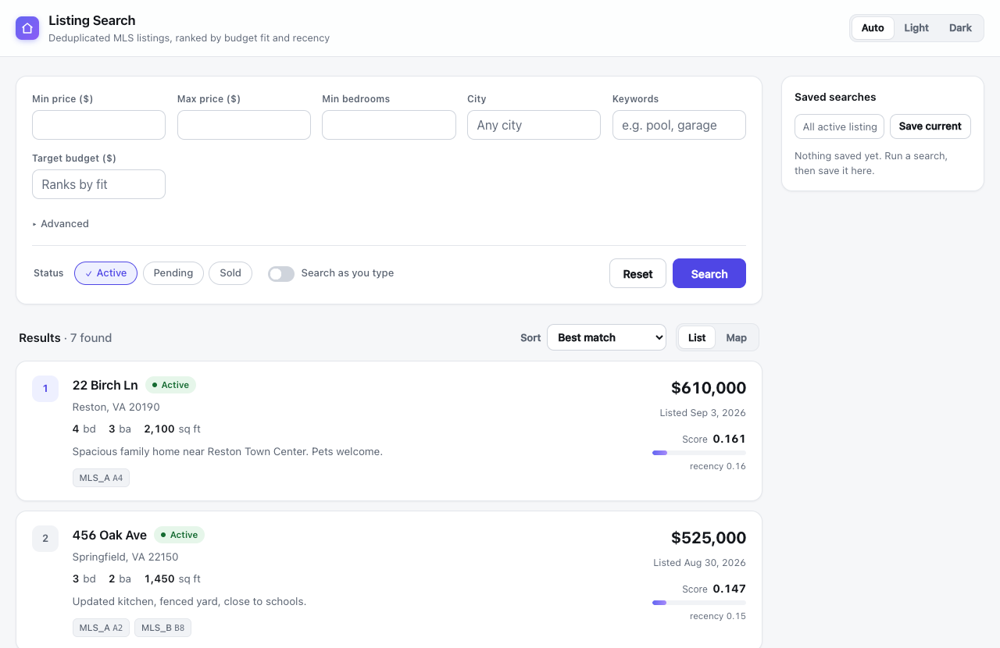
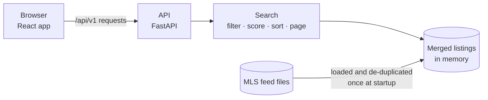

# Listing Search

Listing Search finds homes for sale across several MLS feeds and shows each home once, ranked by how well it fits your budget and how recently it was listed. MLS feeds are the listing databases real estate agents publish to, and the same home often appears in more than one.

It's a full-stack web app built for a software engineering assessment. It runs on a small bundled sample of 12 listings, but it's built and tested the way a production service would be.



## What you can do with it

- Search by price range, bedrooms, city, keywords and status (active, pending, sold).
- Set a target budget to rank homes by how close their price is to it.
- See why each home ranked where it did. Every result shows its score and the two things behind it: budget fit and how new the listing is.
- Switch between a list of cards and a map.
- Open any home for full details, including how each MLS feed described it.
- Sort by best match, newest, price or size.
- Save searches and rerun them later.
- Share any view as a link. The search, sort, page and open listing are all in the URL.
- Use it with a keyboard or screen reader, in light or dark mode, on a phone or a desktop.

## Run it

You need Python 3.10 or newer, and Node 20.19 or newer in the 20 line or 22.12 or newer (Vite's requirement).

```bash
bash start.sh
```

The script installs everything the first time, then starts the app at http://localhost:5173 and the API at http://localhost:8000. Interactive API docs are at http://localhost:8000/docs. Press Ctrl+C to stop both.

To run it the way it would run in production, with Docker:

```bash
docker compose up --build    # then open http://localhost:8080
```

Other ways to run it, and every command, are in [the engineering guide](docs/engineering.md#run-it-other-ways).

## How it works

The app has two parts. The backend is a Python API built with FastAPI. The frontend is a React and TypeScript web app built with Vite. The browser only talks to the API, and the API holds all the search logic.



When the API starts, it reads the feed files, checks every record and merges duplicates, so the 12 sample records become 8 homes. Two records count as the same home when their addresses match after cleanup ("Street" and "St" count as the same) and they sit within 200 meters of each other. Each search then filters those homes, scores them, sorts them and returns one page of results.

The score is 70% budget fit and 30% recency. A home priced at your target budget gets full marks for fit, and the mark falls to zero once the price is 25% away. Recency halves every 30 days a home spends on the market. Without a target budget, homes rank by recency alone. [Ranking and duplicates](docs/ranking.md) explains the formulas and the reasons behind them.

The API is versioned (`/api/v1`). Bad input gets a single error response that lists every problem at once, so the app can highlight all the wrong fields together. [The API reference](docs/api.md) lists every endpoint and parameter.

## Built for production

The data is a sample, but the service around it behaves like a production one:

- Health checks. One endpoint says whether the service is running, and another says whether it can serve searches. Load balancers and Kubernetes use this split to stop sending traffic to a broken instance without restarting it.
- Request IDs. Every request gets an ID that appears in the logs and in error messages, so a user's bug report leads straight to the right log lines.
- Rate limiting. Each client can make about 120 requests a minute. Extra requests are refused with a message saying how many seconds to wait.
- Graceful failure. If the data file is missing or broken, the service still starts and its health check explains what's wrong. If the API is briefly unreachable, the app retries on its own, and shows a "Try again" button only when it has to.
- Security headers on every response, and the API container runs as a non-root user.
- Settings come from environment variables and are checked at startup. [The engineering guide](docs/engineering.md#configuration) lists them.

## How quality is enforced

Checks run automatically at three points:

| When | What runs |
|---|---|
| Every commit | Linters and type checks for the part of the code you changed, in seconds |
| Every push | A dependency security check, all linters, all tests and the end-to-end tests, once per version of the code: pushing files that already passed skips the run |
| Every pull request | The same checks on GitHub Actions, which must pass before anything merges into `main` |

- Test coverage must stay at 95% or above on both the backend and the frontend, or the build fails. Coverage is the share of the code that the tests exercise.
- End-to-end tests drive a real browser through the real app with Playwright. They search, filter, open details, use the map, and check how the app behaves when the API fails.
- Accessibility is tested automatically with axe-core, in a simulated browser and in a real one, including color contrast in both themes.
- The dependency security check blocks a push when a library the app ships with has a high or critical vulnerability that already has a fix. If no fix exists yet, the check only warns, because there's nothing to upgrade to. You can override a block at the prompt, and every override is logged.
- Pull requests follow a template: a short summary, the files changed and why, and checklists for testing and review.

### Screenshots in pull requests

When a pull request changes an end-to-end test, one command (`npm run pr:evidence:publish`) reruns those tests and adds what they saw to the pull request description. That's a screenshot at each step and a browser-style network panel listing every API call, with its status, timing and response. Reviewers can see what a change does without running it themselves. If no end-to-end test changed, nothing is added. Map screenshots show markers without the street map behind them, because the tests block map tiles; a note in the pull request explains this when it applies.

The screenshots are stored on a separate branch in the repository called `pr-evidence`. GitHub can only show an image in a pull request description if the image has a web address, and GitHub has no way to upload an image to a pull request from the command line. A branch gives each image a stable address inside the same repository. Keeping it separate means the images never appear in the code history or in a pull request's list of changed files.

[The engineering guide](docs/engineering.md) covers testing, the checks and the tooling in detail.

## Trade-offs

- The data lives in memory. 12 records don't need a database, and the code that loads data is a single replaceable piece, so adding a database later only changes that piece.
- Keyword search is literal. "pets" also matches "no pets". Fixing that properly means pulling structured facts out of descriptions, which is a product decision.
- "pet" doesn't match "pets". Matching word variants would be a small, contained change.
- Only active listings show by default, as on consumer property sites.
- The ranking weights are reasonable starting values, not tuned on real user behavior.
- Saved searches live in your browser. Syncing them to an account would need sign-in.
- Rate limits are counted per server process. Running several servers would need a shared counter, such as Redis.
- Map tiles come from OpenStreetMap's free public servers, which suits a demo. A production app would pay for a tile provider.

## What's next

The bundled sample stays the default. Two live data sources could plug in behind the same loading code:

- The SimplyRETS demo API, a free live feed in MLS format. Its listings are made up, so it's best for testing a real network connection and duplicate matching across sources.
- The Kaggle "USA Real Estate Dataset", about 2.2 million real listings. Its license is unclear, so it would be downloaded by a script rather than stored in the repository.

## More documentation

- [API reference](docs/api.md): endpoints, parameters, responses and errors.
- [Ranking and duplicates](docs/ranking.md): how scores are calculated and how duplicate listings are merged.
- [Engineering guide](docs/engineering.md): architecture, configuration, testing, quality checks, styling and project layout.
