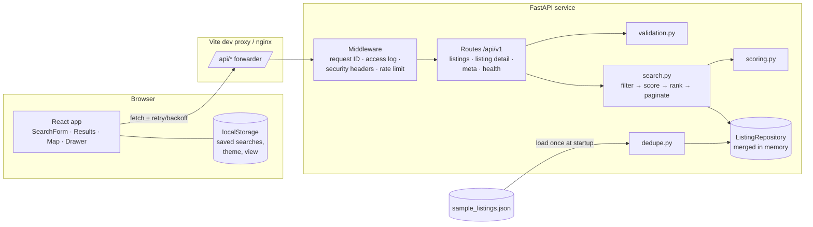

# Engineering guide

How the code is organized, how to run and configure it, and how its quality is checked.

## Run it other ways

`bash start.sh` (see the [README](../README.md#run-it)) checks your Python and Node versions, installs everything on the first run and starts both halves. The other options:

```bash
make setup     # backend virtual environment and dev tools, frontend packages, git hooks
make check     # every linter and test, with coverage thresholds (no e2e)
make e2e       # Playwright end-to-end tests (starts its own servers)
make ci        # vulnerability check + check + e2e: the full gate the pre-push hook runs
make audit     # the dependency vulnerability check on its own
make openapi   # regenerate backend/openapi.json after an API change
```

To run the halves separately, in two terminals:

```bash
# 1. Backend, at http://localhost:8000
cd backend
python -m venv .venv && source .venv/bin/activate      # Windows: .venv\Scripts\activate
pip install -r requirements-dev.txt
uvicorn app.main:app --reload --port 8000

# 2. Frontend, at http://localhost:5173
cd frontend
npm install
npm run dev
```

`docker compose up --build` runs it the way production would, at http://localhost:8080: nginx in front, JSON logs, and the API docs turned off.

In development, Vite forwards `/api/*` requests to `localhost:8000`, so the frontend has no backend address built in. Set `API_URL` to point it somewhere else. In Docker, nginx does the same forwarding.

## Architecture



Two rules shape the code:

1. The logic lives in plain Python modules, and the HTTP layer only connects them to routes. `validation`, `dedupe`, `scoring` and `search` know nothing about FastAPI, so they're tested directly.
2. Every network call in the frontend goes through `src/api.ts`. Components never build URLs or handle HTTP, so retries, cancellation and error handling live in one place.

A search moves through these stages, each a small function in its own module:

```
feed JSON ─► parse and check records ─► merge duplicates ─► (in memory, once at startup)
request ─► middleware ─► validate parameters ─► filter ─► score ─► sort ─► paginate ─► JSON
```

| Stage | File |
|---|---|
| Settings | `config.py` |
| Request IDs, logs, headers, rate limit, handling of unexpected errors | `middleware.py`, `observability.py` |
| Parameter validation | `validation.py` |
| Duplicate merging | `dedupe.py` |
| Scoring | `scoring.py` |
| Filter, sort, paginate | `search.py` |
| Loading and lookup | `repository.py` |
| Routes and error responses | `main.py`, `errors.py` |

A new requirement should touch one place: a new filter goes in `matches_filters`, a new sort in `rank` and `SORT_OPTIONS`, a new ranking signal in `scoring.py`.

## Configuration

Every setting lives in `backend/app/config.py`. They're typed and checked at startup by pydantic-settings, so a bad value stops the service straight away with a clear message, instead of failing on the first request. Set them as environment variables, or in `backend/.env`:

| Variable | Default | Meaning |
|---|---|---|
| `LISTING_ENVIRONMENT` | `development` | `development`, `test` or `production`. Production hides `/docs` and `/openapi.json`. |
| `LISTING_LISTINGS_PATH` | the bundled sample | Feed file to load at startup |
| `LISTING_LOG_LEVEL` | `INFO` | `DEBUG`, `INFO`, `WARNING` or `ERROR` |
| `LISTING_LOG_FORMAT` | `text` | `json` for one JSON object per line, which log tools such as Datadog read. `text` is easier to read by eye. |
| `LISTING_CORS_ORIGINS` | the Vite dev addresses | JSON list of browser origins allowed to call the API directly |
| `LISTING_RATE_LIMIT_ENABLED` | `true` (limiting on) | Set to `false` to turn rate limiting off. The end-to-end tests do this. |
| `LISTING_RATE_LIMIT_PER_MINUTE` | `120` | Steady requests per minute per client IP address |
| `LISTING_RATE_LIMIT_BURST` | `30` | Requests a client can make in a quick burst |

## Running in production

### Logs and tracing

- Every request gets an ID: the caller's `X-Request-ID` header if it's a safe value, otherwise a new random one. The ID is on every log line for that request, in the `X-Request-ID` response header, and in error responses. The app shows it as "Reference: …", so a user's report leads straight to the right log lines. In Docker, nginx creates the ID as the request arrives.
- Each request writes one access-log line with the method, path, query, status, duration and client. With `LISTING_LOG_FORMAT=json`, each line is a JSON object, with any error traceback kept in a single field.
- Every response has a `Server-Timing` header, which shows the server's processing time in the browser's developer tools.
- `/health/live` answers whenever the process is up. `/health/ready` answers 503 when the data didn't load. Kubernetes and load balancers expect this split: they stop sending traffic to an instance that isn't ready, and restart only one that has stopped responding. In Docker, the API image's `HEALTHCHECK` uses the readiness check. The frontend image's `HEALTHCHECK` requests nginx's `/healthz`, which only shows that nginx is serving files. It doesn't check the API, so a healthy frontend container doesn't mean searches work.

### Failure handling

- A missing or corrupt data file leaves the service running but not ready, with the reason in `/health/ready`, so it doesn't crash and restart over and over. Bad individual records are skipped, logged and counted.
- Any unexpected error is logged with its full traceback and request ID, and the caller gets a generic 500 in the standard error shape. Internal details never reach the client.
- Rate limiting uses a token bucket per client IP address, in `middleware.py`: a client can burst up to `RATE_LIMIT_BURST` requests and sustain `RATE_LIMIT_PER_MINUTE`. Refused requests get a 429 with `Retry-After`, and every response carries `RateLimit-Limit` and `RateLimit-Remaining` headers. Health checks are exempt. The counters live in memory, with a cap on how many clients are tracked. Behind several servers, a shared store such as Redis would replace them, and only `TokenBucketLimiter` would change.
- The frontend retries network failures and 429, 502, 503 and 504 responses, waiting longer each time with some randomness added (exponential backoff with jitter), and respects `Retry-After`. It never retries a 400 or 404, because asking again wouldn't change the answer.

### Security headers

Every API response sets `X-Content-Type-Options: nosniff`, `X-Frame-Options: DENY`, `Referrer-Policy: no-referrer` and a `Content-Security-Policy` of `default-src 'none'`. The policy is relaxed only for the docs pages, which load their own scripts. nginx sets a policy for the app itself that allows only its own files plus OpenStreetMap map tiles. The API container runs as a non-root user. The frontend container uses the standard nginx image, whose master process starts as root and runs its worker processes as the unprivileged `nginx` user.

## Frontend

| Feature | Where | Notes |
|---|---|---|
| Search form | `SearchForm.tsx` | Every filter, status toggles, and an Advanced section for page size. `asOf` has no input; it can only be set in the URL. API errors appear next to their fields. |
| Price inputs | `PriceControls.tsx`, `lib/price.ts` | Text boxes that take typed or pasted amounts and show commas, with sliders under them: one two-handle slider for min and max price, one for the target budget. The sliders run from $0 to $50,000,000 in steps that grow with the price ($25,000 below $1M, up to $1,000,000 above $25M). All the way right means no maximum; any amount can be typed, including above $50M. Arrow keys stop a handle at the other one; a mouse or touch drag can pass it, and min and max swap, so overlapping handles can always be pulled apart. Typed amounts are read the way the API's `float()` reads them (`lib/price.ts`, `amountOf`), so the sliders never send a range the API rejects. |
| Search as you type | `App.tsx`, `useDebouncedCallback.ts` | Optional. Sends one search after typing pauses for 400 ms, not one per key press. |
| Results | `ResultsTable.tsx` | Ranked cards with price, details, status badge, score bar and breakdown, and source feeds. Clicking a card opens the details. |
| Sort | `SortControl.tsx` | Applies immediately, from page 1 |
| Map | `MapView.tsx` | Leaflet with OpenStreetMap tiles, one marker per result. Clicking a marker opens the details. |
| Details | `ListingDrawer.tsx` | Facts, the score breakdown and every feed record, in a panel that slides in. Keyboard focus stays inside while it's open, Escape closes it, and focus returns where it was. Shareable with `?listing=…`. |
| Saved searches | `SavedSearches.tsx`, `lib/savedSearches.ts` | Up to 10, stored in the browser in the same format as the URL |
| Theme | `useTheme.ts` | Auto (follows the operating system), light or dark, remembered |
| Pagination | `PaginationControls.tsx` | First, Previous, Next and Last, with "showing X–Y of N" |
| Loading and empty states | `App.tsx`, `ResultsSkeleton.tsx` | Placeholder cards on first load, dimmed results while the next page loads, messages for no results, a page past the end, and warnings, and a "Try again" button when retrying could help |
| Crash screen | `ErrorBoundary.tsx` | A rendering crash shows a recoverable screen instead of a blank page |
| Shareable links | `App.tsx` | The search, sort, page and open listing are all in the URL |
| No out-of-date results | `App.tsx`, `api.ts` | A new search cancels the one still running, including any pending retry |

The page's request state is one `Outcome` value, tagged with the request it answers. Loading isn't stored separately: the page is loading whenever the latest outcome belongs to an older request, so a loading flag can never get stuck or race a response.

### Styling

Styles are SCSS Modules: each component has its own stylesheet next to it, and its class names are made unique when it's built (`.listing` in `ResultsTable.module.scss` becomes something like `_listing_x7k2p`). Two components can't clash, and deleting a component deletes its styles.

```
src/styles/
  _tokens.scss       every color, shadow and corner radius, as one Sass map per theme
  _mixins.scss       focus-ring, input-base, phone and tablet-down breakpoints, reset-list, and more
  global.scss        the only global stylesheet: tokens as CSS variables, reset, reduced motion
  ui.module.scss     shared pieces: card, btn, badge, alert, empty, skeleton bars, sr-only
src/components/
  ResultsTable.tsx + ResultsTable.module.scss   (and the same for every component)
```

- `global.scss` turns the `$light` and `$dark` maps into CSS custom properties (`--bg`, `--text` and so on) on the page. Dark mode applies when the operating system prefers it, unless the user chose Light, or whenever the user chose Dark. The dark map is written once and used for both cases, and the build fails if the two maps ever define different tokens.
- Components use tokens, never raw color values (`color: var(--text-2)`), so every component follows the theme automatically.
- In TypeScript, kebab-case class names are read in camelCase (`styles.cardLink`), and `cx()` in `lib/cx.ts` combines them: `cx(ui.card, styles.listing, selected && styles.selected)`.
- In unit tests, class names keep their plain names (`listing`, `badge-active`) so tests can find them. Real builds use the unique names.
- Every text color meets WCAG AA contrast (4.5:1) against the backgrounds it's used on, in both themes. The Playwright tests check this in a real browser.

## Testing

| Suite | Command | What it covers |
|---|---|---|
| Backend | `cd backend && .venv/bin/pytest --cov` | Validation, duplicate merging, scoring, search and sorting, data loading, settings, logging, middleware (request IDs, headers, error handling, rate limiter), every endpoint, and the OpenAPI contract. The examples in the code's docstrings run as tests too. |
| Frontend | `cd frontend && npm run test:coverage` | A test file for every component, hook and module, including retries, the details panel's keyboard focus, the map (with Leaflet replaced by a test double) and saved searches |
| Accessibility, simulated browser | `npm run test:a11y` | axe-core (WCAG 2.0 to 2.2, levels A and AA, plus best practices) on the whole page in every state, plus landmarks, accessible names, keyboard order and screen-reader announcements. Each component test also runs axe. |
| End-to-end | `npm run test:e2e` | Playwright against the real API and data: search, filters, validation, sorting, paging, search as you type, details and shared links, the map, saved searches, themes, failure handling (outages, retries, 500s), and axe in a real browser, color contrast included, in both themes. Runs at desktop and phone sizes. |

Both halves fail below 95% coverage, measured differently. The backend has one combined threshold over statements and branches together (`fail_under = 95` in `backend/pyproject.toml`); function coverage isn't measured separately. The frontend has four separate thresholds, for statements, branches, functions and lines (`thresholds` in `frontend/vite.config.ts`).

The tests use fixed dates and clocks, so they give the same results on any day. The end-to-end tests block map tiles, so they never need the internet, and they fail any test where the page logs a console error.

On macOS 12, Playwright's own Chromium isn't available, so locally the tests drive your installed Google Chrome. CI uses Playwright's Chromium. Set `PW_CHANNEL` to choose a different browser.

## Quality checks

| Check | Runs on | What it checks |
|---|---|---|
| Pre-commit hook | every `git commit` | Linting, formatting and type checks for the half of the code you changed. Seconds, so it never slows a commit down. |
| Pre-push hook | every `git push` | `make ci`: the dependency vulnerability check, all linting, every test with coverage thresholds, and the Playwright tests. Runs once per version of the code (see below). |
| CI (`.github/workflows/ci.yml`) | every push and pull request | The same checks in parallel jobs, the end-to-end tests, a production build and both Docker images. `backend`, `frontend` and `e2e` must pass before anything merges into `main`. |
| Pull request template (`.github/pull_request_template.md`) | every pull request | A short summary, a table of files changed, checklists for the UI, backend, coverage and a manual test of the running app, an optional diagram, and QA steps for the reviewer |
| PR evidence (`npm run pr:evidence`) | opening or updating a pull request | Screenshots and network captures of every changed end-to-end test, added to the pull request description |

Each check runs once. Tests used to run at both commit and push, so a commit followed by a push tested the same code twice; now they run only at push. The pre-push hook also remembers what it has checked. After the gate passes, it records the commit's tree hash, git's fingerprint of the exact files, which doesn't change when only a commit message, author or date does. Pushing files whose fingerprint is already recorded skips lint, tests and e2e. That happens when you re-push after a dropped connection, push the same branch to a second place, or force-push after rewording commit messages. Only the checked-out commit, with no uncommitted or untracked files, gets recorded, because the gate tests the files on disk. The records are in `.git/checked-trees` in your clone and are never pushed; delete that file to force a full run. Linting can still run at both commit and push, since the commit only lints the half you changed, but it takes seconds.

Changes that only touch documentation skip the checks entirely: any Markdown file, or anything under `docs/`. Pre-commit skips linting when every staged file is documentation. Pre-push compares each branch with what's already on GitHub (for a new branch, with where it left `origin/main`) and skips lint, tests and e2e when every changed file is documentation. Deleted files and renames count by their original paths, so deleting code or moving it into `docs/` is never treated as documentation. If the branch's current commit on GitHub hasn't been fetched, the hook can't see what the push replaces, so it runs everything. CI still runs on the pull request.

The dependency vulnerability check is the exception to all of this: it runs on every push that sends code, including already-checked and documentation-only ones. It reads live advisory data, so code that passed yesterday can have a fixable vulnerability published today, and neither its result nor an override is ever reused.

Install the hooks once per clone with `make hooks` (or `make setup`). They're stored in `.githooks/` and switched on with `git config core.hooksPath .githooks`.

`make hooks` also changes one setting in this clone's git config (`.git/config`, never your global config): it sets `core.sshCommand` to `ssh -o ServerAliveInterval=30 -o ServerAliveCountMax=20`. Git opens its SSH connection to GitHub before the pre-push hook runs and sends the commits after it, and the full check takes a few minutes, long enough for GitHub to drop an idle connection with "the remote end hung up unexpectedly". The keepalive pings the connection every 30 seconds while the hook runs.

- It's only set when you haven't chosen an SSH command yourself. It's skipped if the `GIT_SSH_COMMAND` or `GIT_SSH` environment variable is set when `make hooks` runs, or if `core.sshCommand` is already configured at any level (globally or in this repo, for example to pick an SSH key or use a wrapper tool). In those cases nothing is written, and the installer prints the options to add to your own command. `GIT_SSH` matters most: git ranks it below `core.sshCommand`, so writing the setting would override a `GIT_SSH` wrapper.
- If an earlier `make hooks` added the setting and you've since set one of those variables, running `make hooks` again removes it. Otherwise re-running changes nothing.
- The installer only sees environment variables present when it runs. If you set `GIT_SSH` in a shell profile but ran `make hooks` from somewhere that doesn't load it (an IDE, for example), remove the setting by hand with the command below.
- To check it: `git config --local --get core.sshCommand`
- To remove it: `git config --local --unset core.sshCommand`. Pushes still work; long pre-push runs may drop the connection again.
- It has no effect on HTTPS remotes.

Linters: ruff (style, likely bugs, import order, modern syntax and security rules) and mypy for the backend. oxlint (correctness, React hooks, accessibility and test rules, with warnings treated as errors), Prettier and the TypeScript compiler for the frontend.

### PR evidence

From `frontend/`:

```bash
npm run pr:evidence            # record, then preview in frontend/pr-evidence/EVIDENCE.md
npm run pr:evidence:publish    # record and add it to this branch's pull request
npm run pr:create              # open a draft pull request from the template, then add evidence
npm run pr:evidence -- --all   # record every end-to-end test, not just the changed ones
```

- What's recorded: every test in each end-to-end spec file the branch changes compared with `main`, including uncommitted work. If no spec file changed, nothing is recorded and the pull request is left alone. `pr:create` still opens the pull request in that case.
- For each test: a screenshot at each `evidence.capture('…')` step and of the final state, and every `/api` request with its method, URL, status, timing, `X-Request-ID` and response body. The requests appear as a table and as an image of a DevTools-style Network panel. Requests the app cancelled itself, because a newer search replaced them, show in grey as "(canceled)", as they do in DevTools. Failed tests are marked ❌ and shown expanded.
- Map screenshots: the tests block OpenStreetMap's tiles (see [Testing](#testing)), so the map shows markers on a blank background. When any recorded test tried to load tiles, a note above the evidence says why: tests shouldn't depend on a third-party server or internet access in CI, blocked tiles keep screenshots identical between runs, and OpenStreetMap's usage policy discourages automated traffic. The map loads normally in the running app.
- Where it goes: a pull request description can only show an image that has a web address, and GitHub has no way to upload an image to a pull request from the command line. So the images are pushed to a separate branch, `pr-evidence`, under `pr-<number>/<commit>/`, which gives each one a stable address inside the repository. Being a separate branch with its own history, it never mixes with the code or shows up in a pull request's changed files. Only the part of the description between `<!-- pr-evidence:start -->` and `<!-- pr-evidence:end -->` is replaced, and everything else stays as written. The images use `blob/…?raw=true` addresses, which also work in private repositories.
- How it works: `scripts/lib/cli.mjs` chooses the specs and runs Playwright with `PW_EVIDENCE_DIR` set, which switches on the `evidence` recorder in `e2e/fixtures.ts`. Publishing uses the `gh` command-line tool (run `gh auth login` once). This code is unit-tested like the rest of the frontend.

### Dependency vulnerability check

`scripts/check_vulns.py` checks the libraries the app ships with for known vulnerabilities: `npm audit --omit=dev` for the frontend, and `pip-audit` on `backend/requirements.txt` for the backend, with severity ratings from [OSV](https://osv.dev). Development-only tools never ship, so they aren't checked.

| Finding | `git push` (pre-push hook) | CI |
|---|---|---|
| High or critical, with a fix available | Blocks the push | Warning and annotation |
| High or critical, no fix yet | Reported, doesn't block | Warning and annotation ("presumably there is not yet a fix") |
| Unknown severity | Treated as high | Treated as high |
| Low or moderate | Reported | Logged |
| The check couldn't run (offline, registry down) | Blocks, with the same override | Warning and annotation |

- A fix being available is what decides whether to block. Blocking on a vulnerability nobody can fix yet would stop all work without making anything safer, but once a fix exists there's no reason to ship the vulnerable version.
- CI runs the check with `--report-only`, so a new vulnerability with no fix can never stall the pipeline. Each high or critical finding appears as a GitHub warning on the run and the pull request.
- When the hook blocks a push in a terminal, you can type `override` and a reason to push anyway. Each override is logged with your user name, the time, the reason and the findings in `.git/vuln-overrides.log`. There's no prompt without a terminal (IDE push buttons, scripts), so those stay blocked.

## Project layout

```
.github/      workflows/ci.yml · pull_request_template.md
.githooks/    pre-commit · pre-push
backend/
  app/        main.py (routes) · config.py · middleware.py · observability.py · errors.py
              validation.py · dedupe.py · scoring.py · search.py · repository.py · models.py
  data/       sample_listings.json
  scripts/    export_openapi.py
  tests/      one test module per app module, plus test_api and test_contract
  openapi.json · Dockerfile · pyproject.toml · requirements.txt · requirements-dev.txt
frontend/
  src/        App.tsx (+ App.module.scss) · api.ts · main.tsx · a11y.test.tsx
    components/  SearchForm · PriceControls · ResultsTable · ResultsSkeleton · PaginationControls · SortControl
                 SegmentedControl · StatusBadge · MapView · ListingDrawer · SavedSearches
                 ErrorBoundary   (each with its .module.scss and .test.tsx)
    hooks/       useDebouncedCallback · useLocalStorage · useTheme
    lib/         format · price · savedSearches · cx
    styles/      _tokens · _mixins · global · ui.module   (see Styling)
    test/        fixtures · axe helper
  e2e/        Playwright specs · fixtures (including the PR evidence recorder)
  scripts/    pr-evidence.mjs · lib/ (evidence and cli, with tests)
  Dockerfile · nginx.conf · playwright.config.ts · vite.config.ts
docs/         api.md · ranking.md · engineering.md
scripts/      check_vulns.py (dependency check) · install-hooks.sh · tests/
docker-compose.yml · Makefile · ruff.toml · start.sh
```

Every `.ts` and `.tsx` module has a `.test.ts` or `.test.tsx` file next to it, and every backend module has a `tests/test_*.py`.
